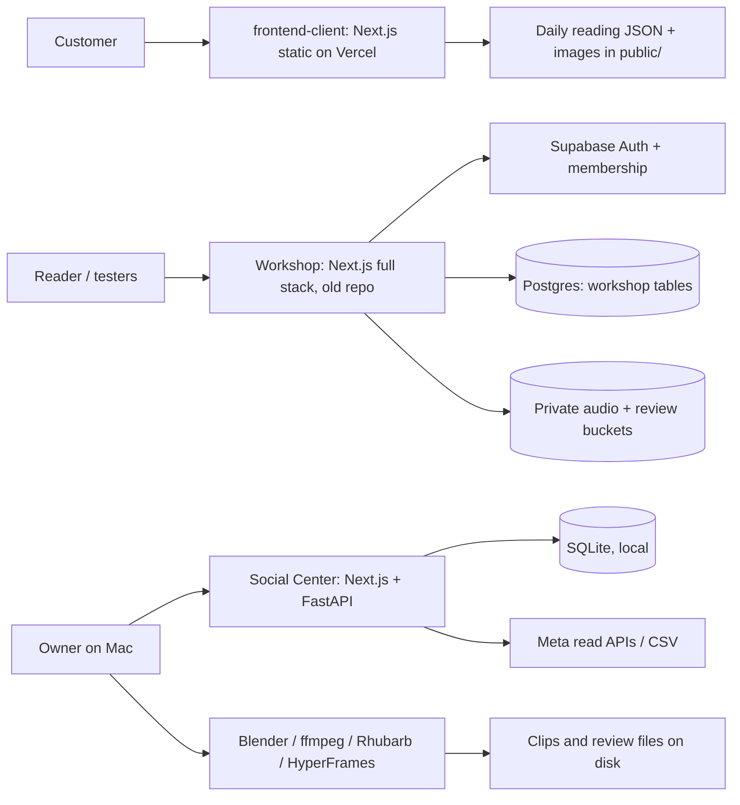
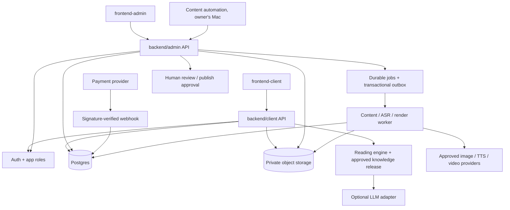

# 03 · Architecture

The "Target" section is a proposal. None of its tables, APIs or queues exist yet.

## Today

- The customer site has no link to workshop answers or audio. Card drawing happens in the browser.
- Social Center is localhost-only with a Keychain token; it cannot be moved to public hosting as is.

## Target (proposal)

**Status 2026-11-24:** the API layer is built as two Rust Workers on Cloudflare (`backend/client`, `backend/admin`). The database is Cloudflare D1 (SQLite), not Postgres, and object storage is R2 (decisions D01 and D02 in `backend/docs/admin/decisions/`). Auth and roles are done (SPEC-001); the reading engine, payments and job queue are not started. The notes below are the original proposal; read "Postgres" as "D1" where they still apply.

### Responsibilities

- **API layer:** login, queries, orders, permission checks, webhooks, job creation. `frontend-client` is a static export (`output: 'export'`), so the customer API must be a separate service, or the frontend deployment mode must change on purpose.
- **Postgres:** source of truth for accounts, credits, readings, knowledge versions and job state. Money changes happen inside transactions. Tables readable by clients use row-level security plus server-side authorization.
- **Storage:** media, audio, video and artifacts live in object storage, not BLOB columns. Separate private inputs, generated drafts and approved public assets. Hand out short-lived signed URLs after a permission check.
- **Reading engine:** normalize intent / topic / situation / time horizon → check scope → apply cards and positions → look up approved knowledge → answer or ask a follow-up → verify evidence before returning. Details in [05](05-reading-engine.md).
- **Worker:** long jobs keep running after the browser closes. The web request returns a job ID; the client polls or subscribes. Start with one worker and one template. Provider adapters so data is not tied to one vendor.

### Hosting notes

- Keep the working web and DB; add a worker only when web-triggered video jobs start.
- The pilot can use the Mac as a worker that **pulls** jobs. Never expose a control port on the Mac.
- Production may use a VM/container or a GPU worker, chosen from measured time, memory and tool needs. Coolify is a deployment option, not a database or queue.
- Never run a full Blender/ffmpeg render inside one HTTP request. Design for runtime limits (see [Vercel function limits](https://vercel.com/docs/functions/limitations)) with durable state.
- Capacity must be measured (workload, peak concurrency, DB pool, egress), not estimated from sign-ups.

### Retrieval, embeddings, speech-to-text

- v1 uses exact lookup by `card_id + category + intent + position + knowledge_version`, which is traceable.
- Add full-text / vector / hybrid search / reranking only when evaluation shows retrieval is the weak point and the corpus is large enough. No external vector store yet.
- Speech-to-text is an ingest/review step for the reader's audio. It does not make readings correct by itself. Store the transcript and the human-corrected text separately.

References: [Supabase RLS](https://supabase.com/docs/guides/database/postgres/row-level-security), [Storage access control](https://supabase.com/docs/guides/storage/security/access-control).
